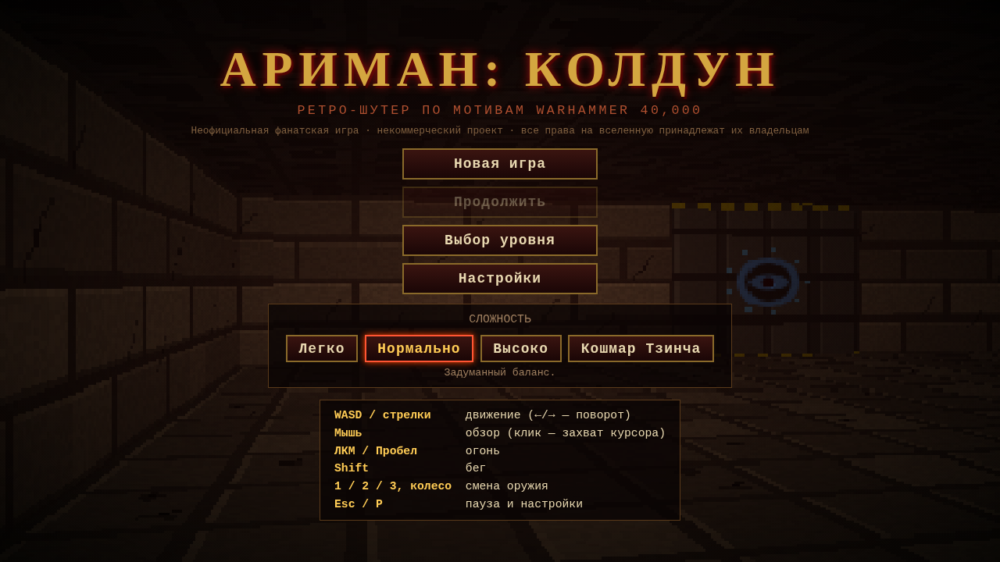

# АРИМАН: КОЛДУН

Браузерный ретро-шутер в духе Doom: луч-кастинг от первого лица, три вида оружия и короткая кампания по мотивам Warhammer 40,000. Это неофициальный некоммерческий фанатский проект; все права на вселенную принадлежат их владельцам.

**[Играть](https://ariman765.github.io/Ahriman-game/)**

## Управление

- **WASD** — движение
- **Мышь** — обзор
- **ЛКМ / Пробел** — огонь
- **Shift** — бег
- **1 / 2 / 3** — оружие
- **Esc / P** — пауза
